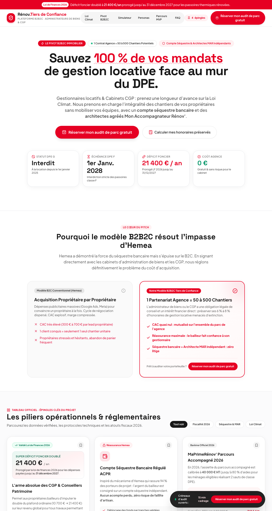

# Rénov Tiers de Confiance 🏛️🔒

> **Plateforme B2B2C de Rénovation Énergétique Clé en Main pour Administrateurs de Biens & Cabinets de Gestion de Patrimoine (CGP)**  
> *Projet Rocket Founders Startup Week 2026 (Rocket School × Change Conseil)*

🌐 **Landing Page en ligne :** [https://theriderymarketing.github.io/renov-tiers-de-confiance/](https://theriderymarketing.github.io/renov-tiers-de-confiance/)

---

## 🎯 Proposition de Valeur & Le Pivot B2B2C

* **Le Problème :** Le mur réglementaire de la Loi Climat :
  * **1er janvier 2025 :** Interdiction totale de louer les passoires thermiques classées **G**.
  * **1er janvier 2028 :** Interdiction étendue aux logements classés **F**.
  * **1er janvier 2034 :** Interdiction étendue aux logements classés **E**.
  * **60 % du parc résidentiel français** date d'avant 1974 (sans isolation initiale).
  * Risque direct pour les gestionnaires : **perte sèche de leurs 6 % à 8 % d'honoraires de gestion locative**.
* **Le Cœur du Pitch (Pivot B2B2C vs Hemea) :**
  * Hemea adresse le grand public (B2C) avec un coût d'acquisition client (CAC) unitaire très élevé (plusieurs centaines d'euros par lead).
  * En pivotant vers le B2B (cabinets d'administration de biens, syndics, CGP), **1 seul contrat signé avec une agence débloque entre 50 et 500 projets de rénovation potentiels**.
* **Nos Piliers Différenciants :**
  1. **0 € de coût** pour le cabinet gestionnaire (gratuité totale et convention stricte de non-démarchage locatif).
  2. **Compte séquestre bancaire régulé ACPR** (zéro avance à risque, déblocage par étapes validées, garantie anti-abandon de chantier).
  3. **Architectes indépendants agréés Mon Accompagnateur Rénov' (MAR)** (garantie de neutralité déontologique sans conflit d'intérêts et éligibilité aux aides publiques Anah).
  4. **Super Déficit Foncier doublé (21 400 € / an)** : prorogé par la loi de finances 2026 pour les dépenses payées jusqu'au 31 décembre 2027.

---

## 👥 Personas Cibles

* **Marc, 42 ans – Directeur de Gestion Locative (ADB) :**
  * Gère 850 lots locatifs diffus, dont 18 % classés F ou G (~150 logements menacés).
  * Gain : Zéro temps passé pour ses collaborateurs, conformité DPE C/D certifiée, préservation de ses mandats de gestion.
* **Sophie, 38 ans – Conseillère en Gestion de Patrimoine (CGP) :**
  * Accompagne 120 familles d'investisseurs multipropriétaires.
  * Gain : Protection contre la décote passoire (-15 % à -25 %), saut de classe DPE garanti et optimisation fiscale via le déficit foncier doublé (21 400 €).

---

## 🔄 Parcours Client MVP en 4 Temps

1. **Détection du lot :** L'administrateur de biens renseigne l'adresse ou importe son listing de logements F/G.
2. **Audit & Scénario MAR :** Un architecte indépendant modélise le scénario garantissant la note C ou D.
3. **Séquestre & Artisans :** Le propriétaire consigne les fonds sous compte séquestre bancaire, les artisans RGE agréés exécutent les travaux sous maîtrise d'œuvre.
4. **DPE C/D & Relocation :** Délivrance du nouveau DPE conforme, libération des fonds et remise immédiate en location par l'agence.

---

## 🛠️ Stack Technique

* **Design :** Direction artistique « Blanc & Rouge » inspiration Pinterest (grille masonry, coins arrondis, badges interactifs, ombres douces).
* **Call To Action (CTA) Unique :** « *Réserver mon audit de parc gratuit* » dupliqué sur toute la page.
* **Simulateur Interactif :** Calcul en direct des lots à risque, des honoraires préservés et du volume de déficit foncier.
* **Technologies :** HTML5, Tailwind CSS, JavaScript Vanilla, Lucide Icons.
